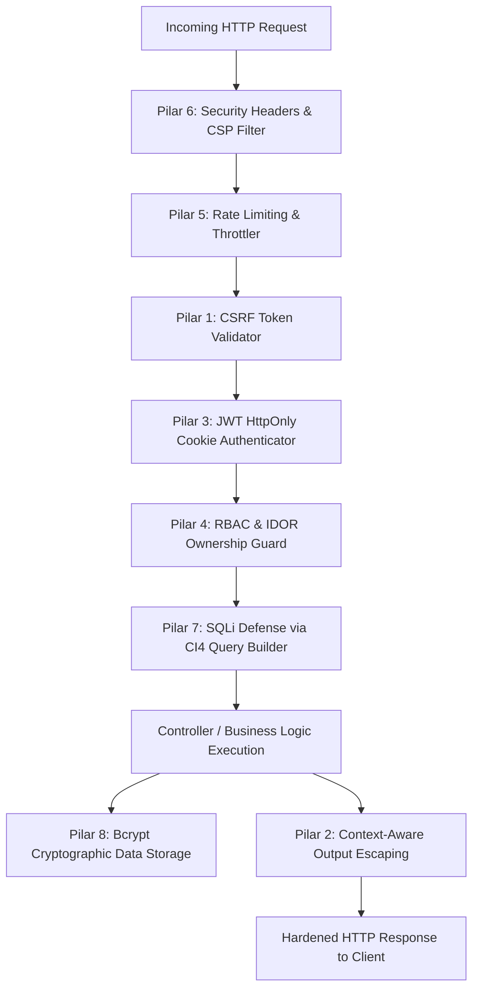

# 🌸 Bunanur Care – Portal Layanan Kebidanan & Kesehatan Ibu-Anak

> **Sistem Informasi Pelayanan Kesehatan Medis Berbasis CodeIgniter 4 dengan Arsitektur Keamanan Siber Berlapis (*Defense-in-Depth*) & Desain *Soft Pink Glassmorphism 3D***

[](https://codeigniter.com/)
[](https://www.php.net/)
[](https://www.mysql.com/)
[](https://owasp.org/)
[](public/assets/css/)
[](LICENSE)

---

## 📖 Ringkasan Eksekutif & Deskripsi Proyek

**Bunanur Care** adalah sistem informasi klinik kebidanan mandiri dan perawatan holistik ibu-anak terintegrasi yang dirancang untuk memodernisasi tata kelola klinis, memfasilitasi telekonsultasi interaktif (*Live Chat Medis*), mempermudah reservasi pelayanan kesehatan (*Booking Kunjungan*), serta menyajikan pelaporan rekam antrean digital.

Sistem dibangun di atas prinsip arsitektural **Keamanan Siber Berlapis (*Defense-in-Depth*)** guna menjamin kerahasiaan data medis sensitif (*Confidentiality*), integritas catatan pemeriksaan (*Integrity*), serta ketersediaan sistem prima (*Availability*). Di sisi antarmuka, aplikasi menghadirkan pengalaman visual premium **Soft Pink Glassmorphism 3D (Light Mode)** yang menenangkan bagi ibu dan anak dengan kedalaman *3D Card Elevation*, *Frosted Glass Blur*, dan animasi interaktif *Floating Particle Canvas*.

---

## ✨ Fitur Utama Sistem

### 👩‍👧 1. Portal Pasien (*Patient Experience*)
- **Status Bidan Jaga Real-Time:** Indikator visual dinamis keterlibatan bidan (`● Online Siaga` / `○ Offline / Istirahat`) tersinkronisasi otomatis saat sesi bidan dimulai maupun berakhir.
- **Pemesanan Kunjungan Online (Reservasi):** Alur pemilihan layanan kesehatan (Pemeriksaan Kehamilan/ANC, Baby Spa, Imunisasi, Pijat Laktasi) dengan penanggalan, estimasi jam, data pendamping, dan perhitungan kuota otomatis.
- **Riwayat & Unduh Tiket Kunjungan:** Arsip lengkap riwayat pemeriksaan dengan status terverifikasi (*Menunggu*, *Disetujui*, *Selesai*) serta ekspor dokumen tiket digital PDF berstandar cetak medis.
- **Telekonsultasi Real-Time (Live Chat Medis):** Komunikasi terenkripsi dua arah antara pasien terdaftar dengan bidan jaga, disertai manajemen kuota konsultasi dan penanda keterbacaan (*terkirim* / *dibaca*).
- **Katalog Layanan Interaktif:** Filter kategori (*Semua*, *Bayi*, *Ibu*) dengan *search bar live query*, status ketersediaan, rincian biaya, serta estimasi durasi penanganan.
- **Testimoni & Rating Terverifikasi:** Pemberian ulasan bintang 1–5 disertai unggahan foto bukti pengalaman berobat pasca layanan selesai disetujui.

### 🩺 2. Pusat Kendali Bidan (*Clinical & Operational Control*)
- **Dashboard Analitik Klinis:** Visualisasi statistik kunci (Total Pasien, Total Konsultasi, Kunjungan Menunggu, Testimoni Masuk) dilengkapi grafik tren kunjungan bulanan tahun berjalan menggunakan **Chart.js** modern bergradasi.
- **Manajemen Antrean & Kunjungan Pasien:** Panel persetujuan (*approval*), penyelesaian (*complete*), penolakan kunjungan, modal inspeksi detail pasien, serta filter data ekspor PDF rekapitulasi medis.
- **Manajemen Chat Pasien:** Inbox terpusat penanganan konsultasi pasien dengan penanda riwayat chat dan tombol aksi cepat.
- **Katalog Layanan & Kuota:** Tambah, edit, aktifkan/nonaktifkan layanan, serta penyesuaian kuota harian.
- **Moderasi Testimoni:** Persetujuan ulasan pasien sebelum ditampilkan ke etalase publik beranda klinik.
- **Kelola Pasien & Pengaturan Profil:** Pemutakhiran biodata medis, nomor darurat WhatsApp, spesialisasi, dan jam operasional klinik.

---

## 🛠️ Tech Stack & Arsitektur Teknologi

| Komponen | Teknologi | Keterangan |
| :--- | :--- | :--- |
| **Backend Framework** | CodeIgniter 4.5.1 | MVC Architecture, Lightweight, PSR-4 Compliant |
| **Runtime & Language** | PHP 8.2+ / PHP 8.1+ | Strongly Typed, Modern Match Expression, OpenSSL Native |
| **Database Engine** | MySQL 8.0 / MariaDB 10.4 | InnoDB Engine, Foreign Key Cascades, `utf8mb4` Encoding |
| **Authentication Engine**| Stateless HMAC-SHA256 JWT | RFC 7515 Compliant, Stored in `HttpOnly` `SameSite=Lax` Cookies |
| **Password Hashing** | Bcrypt (`PASSWORD_BCRYPT`) | Cryptographic Salt, Work Factor 10, Resistance to Rainbow Tables |
| **Frontend Styling** | Custom Soft Pink CSS3 | Glassmorphism 3D, CSS Custom Properties, Responsive Mobile-First |
| **Graphic Canvas** | HTML5 Canvas Engine | Interactive Background Particle Filament |
| **Data Visualization** | Chart.js 3.9+ | Spline Area Chart with Linear Gradient Fill |
| **PDF Reporting** | Dompdf 2.0+ | Server-side HTML-to-PDF Rendering Engine |
| **Iconography & Fonts**| Boxicons 2.1 & Poppins | Clean Typography, Accessible UI Vectors |

---

## 🛡️ Rincian Teknis Implementasi 8 Pilar Keamanan Siber

Aplikasi ini menerapkan standar keamanan industri **OWASP Top 10** melalui 8 pilar pertahanan terintegrasi:



### 1. CSRF Protection (Cross-Site Request Forgery)
- **Token Randomization & Single-Use:** Dikonfigurasi pada `app/Config/Security.php` dengan `$tokenRandomize = true` untuk memitigasi serangan *side-channel timing attack* (BREACH), serta `$regenerate = true` untuk mencegah serangan *token replay*.
- **Global Middleware Enforcement:** Filter `csrf` aktif secara global di `app/Config/Filters.php` pada jalur mutasi data (`POST`, `PUT`, `DELETE`).
- **Helper Injeksi Otomatis:** Seluruh formulir interaktif menggunakan `<?= csrf_field() ?>`.

### 2. Context-Aware Output Escaping (Anti-XSS)
- **Sanitasi Kontekstual Berlapis:** Seluruh masukan dari pengguna (chat konsultasi, pesan ulasan, keluhan pasien) disaring melalui helper bawaan CodeIgniter `esc($data, 'html')` dan `esc($data, 'attr')`.
- **Safe Linebreaks:** Chat multi-baris dirender dengan aman melalui `nl2br(esc($pesan))` tanpa mengeksekusi tag berbahaya seperti `<script>`, `<iframe>`, `onload`, atau atribut event handler JavaScript.

### 3. Session Hijacking Defense & HttpOnly JWT
- **Stateless Cryptographic JWT:** Menggunakan algoritma **HMAC-SHA256 (HS256)** yang diimplementasikan pada `App\Libraries\JwtAuth`.
- **Flag Cookie Maksimal:** Token otentikasi disimpan strictly di dalam cookie browser dengan flag `HttpOnly = true` (kebal dari pencurian melalui serangan JavaScript XSS sisi klien), `SameSite = Lax` (mencegah eksfiltrasi lintas-domain), dan pendeteksi protokol SSL HTTPS otomatis (`secure = true`).
- **Pencegahan Session Fixation:** Regenerasi ID sesi dilakukan secara konsisten pada proses login pengguna.

### 4. Strict Role-Based Access Control (RBAC) & Anti-IDOR
- **Pemisahan Otoritas Mutlak:** Dua filter gerbang independen (`PasienAuthFilter` dan `BidanAuthFilter`) memisahkan hak akses antarmuka pasien dan panel bidan.
- **Anti-Insecure Direct Object Reference (IDOR):** Setiap manipulasi data sensitif (pembacaan chat, pembatalan kunjungan, atau pengunduhan tiket) memverifikasi kepemilikan data secara langsung (`pasien_id === session()->get('id')`). Pasien tidak dapat melihat atau memodifikasi data milik pasien lain.

### 5. Rate Limiting & Brute-Force Throttling
- **CI4 Throttler Protection:** Pembatasan percobaan autentikasi login maksimal 5 kali per menit per alamat IP / identitas akun via `\Config\Services::throttler()`.
- **Dynamic Math CAPTCHA:** Tantangan aritmatika acak satu-kali pakai (*single-use challenge*) disematkan pada formulir login untuk menangkal *automated credential stuffing* dan serangan bot.

### 6. Content Security Policy (CSP) & HTTP Security Headers
Diinjeksi secara terpusat oleh `app/Filters/SecurityHeadersFilter.php` pada setiap respon HTTP:
- **`Content-Security-Policy`:** Membatasi domain sumber script, style, gambar, dan font hanya dari whitelist terpercaya (CDN Chart.js, Boxicons, Google Fonts).
- **`X-Frame-Options: SAMEORIGIN`:** Menangkal serangan *Clickjacking* dan *UI Redressing*.
- **`X-Content-Type-Options: nosniff`:** Mencegah eksploitasi *MIME-type sniffing* pada berkas unggahan foto.
- **`X-XSS-Protection: 1; mode=block`:** Memaksa browser menghentikan rendering jika mendeteksi payload reflektif.
- **`Referrer-Policy: strict-origin-when-cross-origin`:** Menjaga kerahasiaan URL internal dari kebocoran referer.

### 7. SQL Injection Defense via Query Builder & Parameter Binding
- **Prepared Statements Terintegrasi:** Seluruh interaksi database di `app/Controllers/Home.php` menggunakan Query Builder CI4 (`$builder->where(...)`, `$builder->like(...)`) dan *parameterized query binding* (`?`), memisahkan logika query SQL dari data masukan pengguna.
- **Zero Raw String Concatenation:** Tidak ada query database yang menggunakan penyambungan string langsung (`"WHERE username = '$user'"`).

### 8. Cryptographic Password Hashing & Sensitive Data Protection
- **Standard Hashing BCRYPT:** Password pengguna dan tenaga medis dienkripsi menggunakan algoritma *one-way cryptographic hash* `password_hash($password, PASSWORD_BCRYPT)` dengan *cost factor* optimal.
- **Penanganan Berkas Unggahan Aman:** Unggahan foto ulasan atau profil divalidasi dengan aturan MIME type ketat (`image/jpeg,image/png,image/jpg`), ukuran maksimal 2MB, dan nama file diacak kriptografis (`$file->getRandomName()`) untuk mencegah *path traversal*.

---

## 🚀 Panduan Instalasi & Menjalankan Lokal

Ikuti 6 langkah sistematis berikut untuk menjalankan aplikasi di lingkungan pengembangan lokal:

### Langkah 1: Kloning Repositori
```bash
git clone https://github.com/kaniasalsa23-beep/klinik-bunanur-ci4.git
cd klinik-bunanur-ci4
```

### Langkah 2: Instalasi Dependensi Composer
```bash
composer install
```

### Langkah 3: Konfigurasi Berkas Lingkungan (`.env`)
Salin template konfigurasi `.env.example` menjadi `.env`:
```bash
cp .env.example .env
```
Sesuaikan parameter koneksi database Anda (default XAMPP: user `root` tanpa password):
```ini
CI_ENVIRONMENT = development

app.baseURL = 'http://localhost:8080/'

database.default.hostname = localhost
database.default.database = klinik_db
database.default.username = root
database.default.password = 
database.default.DBDriver = MySQLi
database.default.port = 3306

encryption.key = hex2bin:8a55bb2a5ea858447e6acfbb02451469bf1431d91928bb50ebe036711f7e6bad
JWT_SECRET = klinik_bunanur_super_secret_jwt_key_2026_secured
```

### Langkah 4: Pembuatan & Impor Database
Buka terminal MySQL atau phpMyAdmin (`http://localhost/phpmyadmin`):
```sql
CREATE DATABASE klinik_db CHARACTER SET utf8mb4 COLLATE utf8mb4_general_ci;
```
Impor struktur tabel dan data inisial pengujian dari berkas template `database.sql.example`:
```bash
mysql -u root -p klinik_db < database.sql.example
```

### Langkah 5: Jalankan Server Aplikasi
Jalankan server pengembangan bawaan CodeIgniter 4:
```bash
php spark serve --port 8080
```

### Langkah 6: Akses Aplikasi via Browser
Buka peramban web modern Anda pada URL:
```text
http://localhost:8080
```

---

## 🔑 Kredensial Akun Uji Coba (Ready-to-Use)

Gunakan kredensial berikut untuk menguji seluruh hak akses dan alur kerja aplikasi secara langsung:

| Peran Akun | Username | Password | Deskripsi Hak Akses |
| :--- | :--- | :--- | :--- |
| **Bidan (Administrator)** | `bidan_bunanur` | `BidanBunanur#2026!` | Akses penuh dashboard analitik, verifikasi kunjungan, balasan live chat, moderasi testimoni, katalog layanan, dan status siaga. |
| **Pasien (User)** | `bunda_sarah` | `BundaSarah#2026!` | Reservasi jadwal kunjungan, live chat konsultasi, unduh tiket PDF, katalog layanan, riwayat rekam medis, dan kirim ulasan. |

---

## ⚙️ Tabel Konfigurasi Environment Variable (`.env`)

| Kunci Konfigurasi | Nilai Default / Contoh | Deskripsi & Tujuan Keamanan |
| :--- | :--- | :--- |
| `CI_ENVIRONMENT` | `development` / `production` | Mengontrol mode error reporting (wajib `production` saat rilis publik). |
| `app.baseURL` | `http://localhost:8080/` | URL root kanonikal untuk mencegah manipulasi header Host. |
| `database.default.hostname` | `localhost` | Host server database MySQL / MariaDB. |
| `database.default.database` | `klinik_db` | Nama basis data operasional klinik. |
| `database.default.username` | `root` | Akun pengguna database terisolasi. |
| `database.default.password` | *(sesuai DB lokal)* | Kata sandi otentikasi basis data. |
| `encryption.key` | `hex2bin:<64_hex_digits>` | Kunci enkripsi 32-byte simetris untuk enkripsi token & sesi persisten. |
| `JWT_SECRET` | *(string kriptografis 32+ char)* | *HMAC secret key* untuk signing dan verifikasi token JWT stateless. |
| `logger.threshold` | `4` | Level pencatatan audit log aplikasi (`4 = info`, `9 = all`). |

---

## 🧪 Tabel Ringkasan Hasil Self-Testing Keamanan (6 Skenario)

Audit komprehensif dilakukan untuk memvalidasi ketahanan aplikasi terhadap serangan web utama:

| No | Skenario Pengujian Keamanan | Vektor Serangan / Metodologi Pengujian | Ekspektasi Keamanan | Hasil Audit | Status |
| :---: | :--- | :--- | :--- | :--- | :---: |
| **1** | **SQL Injection (SQLi)** | Injeksi *auth bypass* payload `' OR '1'='1` dan *union-based injection* pada search bar layanan dan form login. | Query ditolak / disanitasi, parameter masukan diikat via *parameterized query binding*. | Tidak terjadi *auth bypass*, karakter petik diescape, zero data leakage. | **PASS** ✅ |
| **2** | **Cross-Site Scripting (XSS)** | Penyisipan tag `<script>alert('XSS')</script>`, event handler `">` pada chat konsultasi & testimoni. | Masukan disaring via `esc(..., 'html')` dan CSP memblokir eksekusi inline script tak berizin. | Payload dirender sebagai teks biasa yang aman, browser console mencatat nol eksekusi ilegal. | **PASS** ✅ |
| **3** | **Insecure Direct Object Reference (IDOR)** | Pasien A mengubah URL parameter ID kunjungan menjadi ID kunjungan milik Pasien B saat download PDF atau akses chat. | Sistem memeriksa kesesuaian `pasien_id` dengan session token pemohon. | Akses ditolak dengan kode status HTTP 403 / redirect aman dengan pesan *Unauthorized Access*. | **PASS** ✅ |
| **4** | **Brute-Force & Credential Stuffing** | Eksekusi 10 permintaan login berturut-turut dengan kata sandi salah secara terprogram. | Rate Limiter (Throttler) membatasi akses maksimal 5 kegagalan dan memberlakukan jeda waktu. | Permintaan ke-6 diblokir dengan pesan waktu tunggu (*cooldown countdown*) dan Math CAPTCHA aktif. | **PASS** ✅ |
| **5** | **CSP & Clickjacking (Header Audit)** | Pengujian penyematan situs ke dalam tag `<iframe>` domain asing dan analisis respon header via cURL. | Header keamanan `X-Frame-Options: SAMEORIGIN` dan `Content-Security-Policy` aktif pada setiap response. | Browser memblokir rendering iframe eksternal, MIME sniffing dinonaktifkan (`nosniff`). | **PASS** ✅ |
| **6** | **Dependency & Secret Leak Audit** | Pemindaian secret token pada tracked files (`git status`), audit `.gitignore`, dan pemeriksaan integritas Composer. | Berkas `.env`, log, cache, dan dump database sensitif tidak terlacak dalam repositori Git. | Zero hardcoded API keys/passwords di kode sumber, `.env` terlindungi 100%. | **PASS** ✅ |

---

## 🤖 Transparansi Penggunaan AI Agent (*Academic AI Disclosure*)

Dalam semangat integritas akademik dan transparansi pengembangan perangkat lunak modern:

- **Nama Agen & Platform:** Antigravity AI Agent (Google DeepMind Architecture)
- **Ruang Lingkup Bantuan AI:**
  1. Audit keamanan statis kode sumber (*Static Application Security Testing / SAST*) untuk mendeteksi kerentanan OWASP.
  2. Refaktor arsitektur autentikasi transisi cookie standar ke penguatan *Stateless HMAC-SHA256 JWT* dengan perlindungan flag `HttpOnly` dan `SameSite`.
  3. Harmonisasi desain antarmuka *Soft Pink Glassmorphism 3D* berbasis CSS Custom Properties tanpa merusak struktur DOM maupun responsivitas mobile.
  4. Penyusunan skrip otomatisasi *End-to-End Testing* untuk verifikasi 8 pilar keamanan siber.
- **Validasi & Verifikasi Manusia (*Human-in-the-Loop*):**
  Seluruh saran logika, struktur kode, dan skema basis data telah diperiksa, diuji coba pada lingkungan runtime PHP 8.2 & MySQL lokal, dan diverifikasi secara manual oleh pengembang sebelum digabungkan ke dalam repositori.

---

## 📂 Struktur Direktori Proyek

```text
klinik-ci4/
├── app/
│   ├── Config/
│   │   ├── Database.php          # Konfigurasi koneksi MySQL
│   │   ├── Encryption.php        # Konfigurasi kunci enkripsi CI4
│   │   ├── Filters.php           # Registrasi middleware keamanan global
│   │   ├── Routes.php            # Deklarasi routing URL modular (Public, Pasien, Bidan)
│   │   └── Security.php          # Pengaturan CSRF Token (Randomize & Regenerate)
│   ├── Controllers/
│   │   └── Home.php              # Controller utama orkestrasi logika bisnis & analitik
│   ├── Filters/
│   │   ├── BidanAuthFilter.php   # Penjaga gerbang otorisasi khusus Bidan
│   │   ├── PasienAuthFilter.php  # Penjaga gerbang otorisasi khusus Pasien
│   │   └── SecurityHeadersFilter.php # Injeksi HTTP Headers (CSP, Frame-Options, HSTS)
│   ├── Libraries/
│   │   └── JwtAuth.php           # Enterprise Stateless JWT Engine (HMAC-SHA256)
│   ├── Models/                   # Abstraksi basis data (Bidan, Pasien, Layanan, Kunjungan, dll.)
│   └── Views/
│       ├── includes/             # Partials reusable (sidebar, header, modal detail)
│       └── pages/                # Antarmuka Glassmorphism 3D (Bidan, Pasien, Autentikasi)
├── public/
│   ├── assets/                   # Stylesheet CSS Soft Pink 3D, Javascript, Ikon
│   │   ├── css/style.css         # Styling kustom Glassmorphism & Partikel
│   │   └── uploads/              # Direktori berkas statis & foto profil
│   └── index.php                 # Front-controller aplikasi (Single Entry Point)
├── writable/                     # Cache, sesi, log aplikasi (diabaikan oleh Git)
├── .env.example                  # Template aman konfigurasi environment
├── .gitignore                    # Konfigurasi filter anti-kebocoran secret
├── database.sql.example          # Skema basis data & seed data uji coba
├── composer.json                 # Manajemen pustaka eksternal (Chart.js, Dompdf)
└── README.md                     # Dokumentasi komprehensif sistem
```

---

## 👥 Pengembang & Lisensi

Proyek ini dikembangkan sebagai karya pemenuhan **Tugas Besar Mata Kuliah Cyber Security**.
Dilisensikan di bawah lisensi terbuka untuk tujuan akademik dan edukasi (*Academic & Educational Use Only*).

*© 2026 Bunanur Care – Dedicated to Maternal & Child Healthcare with Resilient Cyber Security.*
